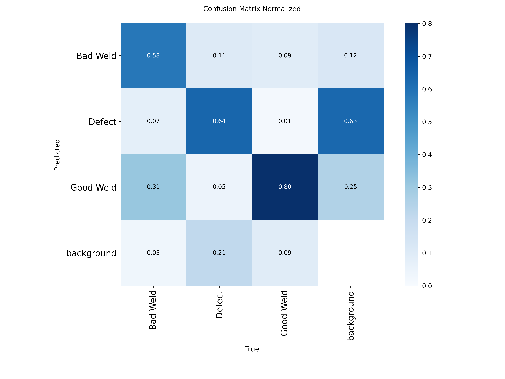
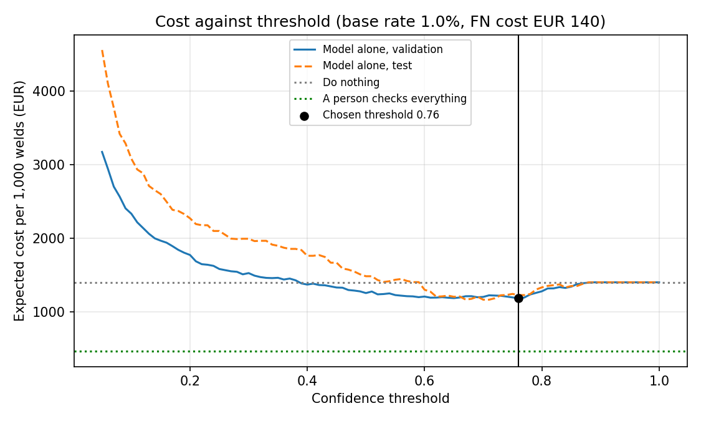

# Assignment 2 Report

- **Name**: María Román
- **Student ID**: 19991
- **Email**: mroman.ieu2022@student.ie.edu
- **Group**: BBADBA 5A

---

## Business problem, and the cost of being wrong

**Decision supported.** A tier-1 automotive supplier welds steel chassis brackets in three robotic cells, two shifts a day. A camera photographs every weld seam as it leaves the cell. For each weld the system makes one of three calls:

- **Pass**: the bracket continues to packing.
- **Fail**: the bracket goes to the rework station (grind out and re-weld).
- **Human review**: a qualified inspector looks at the image on a screen and makes the call.

**One case is one weld seam.** The **positive class is a defective (non-conforming) weld**. The mapping from dataset classes to positive and negative is fixed in the Dataset section.

**Who acts on it today.** A qualified inspector or QA technician judges welds by eye. The relevant standard is ISO 17637:2016 (visual testing of fusion-welded joints). It says final acceptance by visual testing is done by qualified personnel, and that an inconclusive visual result should be backed up by another surface inspection method. That "inconclusive" case is what the human-review outcome represents here.

**Which mistake is worse, and by how much.** A false negative (a defective weld ships) is roughly **70 times** more expensive than a false positive (a good weld is flagged): about €140 against €2 per weld. A false positive is caught inside the factory and costs a few minutes of technician time. A false negative is found later, at the customer or in the field, where it is multiplied by sorting, chargebacks and warranty, with a small chance of a recall campaign. Recall costs can land on the supplier: in one case the vehicle maker recovered about 90% of a battery recall bill from its supplier (Warranty Week, 2026), and OEMs commonly split warranty and recall costs 50/50 as a simplification (Plante Moran). The figures are built up in the cost section below.

**Scope limit.** A camera sees surface defects only. Internal flaws (for example buried porosity) need radiography or ultrasound and are out of scope.

---

## Dataset

- Roboflow workspace / project / version: workspace-4nvpa / welding_defects-vwoj6 / v1 (generated 11 Dec 2025)
- Link: https://universe.roboflow.com/workspace-4nvpa/welding_defects-vwoj6
- Not forked: public dataset used as is (CC BY 4.0).
- What one image represents: A photo of steel parts with one or more weld seams. Each seam or flaw is boxed and labelled Bad Weld, Defect or Good Weld.
- Classes, and which are positive or negative: Good Weld is negative. Bad Weld and Defect are positive. A case is one labelled object: a Good Weld is a negative case, a Bad Weld or a Defect is a positive case. 67% of Defect boxes lie inside a Good Weld or Bad Weld box, so a Defect is usually a flaw on a seam, not a separate seam. Counting each flaw as its own positive case is a simplification: it gives more positive cases than there are defective seams.
- Why this dataset serves the problem above and does not just resemble it: It has a Good Weld class as well as the two defective classes, so I can measure false alarms on good welds and not only detections of defects. The decision it supports (is this weld acceptable?) is the one an inspector makes. Its limits: from the sample images the parts look like plates and test pieces rather than chassis brackets, and lighting and background vary between images.

## What the dataset's composition implies

- Instances per class (train / val / test): Bad Weld 2,187 / 127 / 67; Defect 3,842 / 193 / 66; Good Weld 3,292 / 253 / 76.
- Train / val / test sizes: 2,502 / 176 / 74 images (91% / 6% / 3%). The export adds augmented copies to train (horizontal flip, rotation of +/-15 degrees); counting distinct source file names gives 542 distinct source images in train. Val and test are not augmented. Images are auto-oriented and stretched to 512x512.
- Typical object size relative to the image: the median box is 22% x 22% of the image for Bad Weld (5.7% of the area), 18% x 19% for Good Weld (3.1%) and 12% x 12% for Defect (1.5% of the area). The smallest tenth of Defect boxes is below 0.43% of the area, a square about 7% of the image width (roughly 34 px at 512 px).
- Which per-class numbers are too thin to trust: Each class has only 66 to 76 instances in the test split (74 images), so per-class precision, recall and AP are noisy: one extra miss moves recall by about 1.5 points. There are only 76 good welds in test, so the false-alarm rate has a wide error margin.
- Does the test split resemble real production images (fixed line camera, consistent lighting)? Only partly. The images are overhead shots of steel parts, similar to a fixed camera, but lighting and background vary and the parts are not chassis brackets. Every image has at least one label, so the model never sees an empty background. The dataset is also enriched with defects: 64% of labelled objects in the test split are Bad Weld or Defect, against an assumed 1% on a real line, so I re-weight to the assumed base rate before costing.
- Possible duplicates or leakage between splits: Yes. By image hash (flips included), 11 of the 74 test images (15%) and 19 of the 176 validation images (11%) look like a training image, and 1 test image shares a source file name with train. The test score is therefore optimistic.
- What I therefore cannot conclude from my results: That the model will perform this well on new parts or a different camera. Part of the test set is near-duplicate of training images, the test set is small, and the images are not from the intended production line. The results show that the pipeline and the cost logic work, not how many defects the model would catch on a real line.

## Finetuning and baselines

- Task (detection or classification) and model, and why: Object detection with yolo11n (the "nano" model, 2.6 million parameters), fine-tuned from the COCO-pretrained checkpoint. I chose detection because one image holds several seams and the decision is per weld; classification would give one label per image. The nano size is more than fast enough for about 9 welds per minute (a few milliseconds per image on a T4 GPU) and trains in about half an hour on a free GPU.

- Where I trained, hardware, settings (epochs, image size, seed): Google Colab, Tesla T4 GPU, running train.py (the same code main.py train runs). yolo11n fine-tuned from the COCO-pretrained checkpoint; 60 epochs (the maximum I set; early stopping with patience 20 never triggered), image size 512, batch 16, seed 0, 26.9 minutes. Ultralytics 8.4.190, PyTorch 2.11.0.

- Results on the same test split (74 images, 209 labelled welds). Precision and recall for the fine-tuned model are Ultralytics' values at the confidence that maximises F1; AP is threshold-free:

| Model | Precision | Recall | AP50 | mAP50-95 |
|---|---|---|---|---|
| Fine-tuned yolo11n (model alone, threshold 0.76) | 0.621 | 0.535 | 0.590 | 0.331 |
| Pretrained COCO, zero-shot (any box flags the weld) | 0.000 | 0.000 | 0.000 | 0.000 |
| Trivial: predict nothing (every weld passes) | 0.000 | 0.000 | 0.000 | 0.000 |

- What changed, and whether the gap is as large as I expected: Fine-tuning takes AP50 from 0.000 to 0.590. The zero for COCO is exact, not measured: COCO has 80 everyday classes and none is a weld. It still fired on 21 of the 74 test images, labelling boxes person, bed, cup, banana and spoon. Read generously (any box flags the weld), it costs €2,051 per 1,000 welds, 47% more than doing nothing (€1,400), because it pulls good welds for no reason. The gain in AP is large, but the gain in euros is modest: the fine-tuned model alone costs €1,226 per 1,000 welds (12% less than doing nothing), and €947 (32% less) once a human-review band is added.

- Best weights committed to `weights/`: `weights/best.pt` (5.5 MB), the checkpoint with the best validation score from the 60-epoch run. The run used all 60 epochs, so the model may still have been improving; I did not train longer.

## Per-class evaluation and failure modes

- Positive class: defective weld.
- Per-class results on the test split:

| Class | Test instances | Precision | Recall | AP50 | mAP50-95 |
|---|---|---|---|---|---|
| Bad Weld | 67 | 0.723 | 0.537 | 0.669 | 0.400 |
| Defect | 66 | 0.499 | 0.422 | 0.454 | 0.201 |
| Good Weld | 76 | 0.643 | 0.645 | 0.645 | 0.392 |
| **All** | 209 | 0.621 | 0.535 | 0.590 | 0.331 |

- Confusion matrix (test split, normalised, confidence 0.25, IoU 0.45; counts in results/test_confusion_matrix.png):

- Which class carries the headline number, which one drags: Bad Weld carries it (AP50 0.669, precision 0.723). Defect drags it down: AP50 0.454, recall 0.422, mAP50-95 0.201, so the model finds fewer than half of the Defect boxes. Defect is also the smallest object (median 1.5% of the image area, against 5.7% for Bad Weld), which is a likely reason, but I did not test it. Good Weld recall is 0.645, so about a third of good welds are not recognised as good, which matters for the false-alarm rate.

- What the model confuses with what, with example images: Reading the raw counts (test split; rows are what the model predicted, columns what the weld really is), the two seam classes are confused with each other far more than with Defect. 21 of 67 Bad Welds (31%) are called Good Weld, and 7 of 76 Good Welds (9%) are called Bad Weld. The costly mistake is a defect called good: 24 of the 133 defective objects (18%; 21 Bad Weld and 3 Defect) are matched to a Good Weld prediction, and 16 more (12%; 2 Bad Weld and 14 Defect) are missed entirely, so about 30% of defective objects are not labelled defective by the model's best-matching box. Defect is the class most often missed entirely: 14 of 66 (21%). The matrix is drawn at a very low confidence (0.001), which is why it also shows 1,622 predicted boxes that match no labelled weld (1,021 of them Defect); the cost analysis counts only boxes above its thresholds. Example images: upload any image from results/examples into the dashboard to see these errors.

---

## Cost matrix and operating point

### Cost per outcome (euros per weld)

| Outcome | What happens | Cost | Because |
|---|---|---|---|
| **True negative** (good weld, passed) | Nothing | **€0** | No action taken. |
| **False positive** (good weld, flagged) | Bracket pulled, re-checked, returned to the line. 10% of the time it is needlessly reground and re-welded. | **€2** | 3 min pull and re-check = €1.25. 10% x 10 min rework = €0.42. Total €1.67, rounded up to €2 for handling. Labour at €25/h (see assumptions). |
| **True positive** (defect caught) | Bracket pulled, ground out, re-welded | **€6** | 3 min handling (€1.25) + 10 min rework (€4.17) + about €0.60 consumables **(assumption)**. |
| **False negative** (defect ships) | Expected cost of an escaped defect, built up below | **€140** | Probability-weighted cost of three downstream outcomes. |

**Cost ratio FN : FP = 70 : 1.**

### How the false negative figure is built

Most defective welds that ship never cost anything, because designs carry safety margin. A few cost a lot. So the false-negative cost is an expected value, not a fixed bill.

| Downstream outcome | Probability per escaped defect | Cost if it happens | Expected cost |
|---|---|---|---|
| Customer finds it: sorting, containment, chargeback | 2.5% **(assumption)** | €2,000 **(assumption)** | €50 |
| One vehicle fails in service: tow, repair, goodwill | 0.5% **(assumption)** | €3,000 **(assumption)** | €15 |
| Recall campaign on the affected lot | 0.01% **(assumption)** | €760,000 | €76 |
| **Total** | | | **about €141, used as €140** |

Where the campaign cost comes from: one analysis puts the all-in cost of a recall at about USD 850 per vehicle, which that paper converts to about EUR 760 (USD 10.3 billion over 12.1 million vehicles, Atlas Copco whitepaper; the underlying data is from a 2016 study, so treat it as an order of magnitude). I assume a 2,000-vehicle lot and a 50% supplier share: 2,000 x €760 x 50% = €760,000.

For context on tail risk, Siemens (2024) reports that an idle large automotive production line can cost up to about USD 2.3 million per hour. A line stoppage at the customer is not in my arithmetic, but it is why I do not treat the tail as negligible.

### Operating assumptions

| Assumption | Value | Because |
|---|---|---|
| Output | 1,500 brackets/day | Three robotic cells at about 500/day each. A 2025 study of a tier-1 robotic welding operation reports daily output above 450 units per machine, so this is the right order of magnitude **(assumption)**. |
| Welds per bracket | 6 **(assumption)** | A typical bracket has a handful of seams. |
| Welds per day | **9,000** (about 9.4 per minute over 16 h) | 1,500 x 6. |
| Base rate of defective welds | **1%** (90 per day) | Vendor articles citing American Welding Society data say calibrated robotic cells run below 1% defective, against 5 to 8% for manual welding. I use 1% as the upper end of that range. **Weak source** (vendor blog). Sensitivity range: 0.1% to 5%. |
| Labour cost | **€25/hour** | INE Quarterly Labour Cost Survey, Q1 2026: €24.88 per effective hour (all sectors). A skilled QA technician may cost more; this is conservative. |

### What these numbers imply before any model is trained

Simple expected-value calculations per weld. The real analysis below uses the model's actual errors.

1. **The ideal flagging rule.** For a perfectly calibrated model, flag a weld when the probability it is defective is above FP / (FN - TP + FP) = 2 / (140 - 6 + 2) = **about 1.5%**. That is close to the 1% base rate, so only welds that look worse than average should be flagged.
2. **Flagging everything is worse than doing nothing.** Ignoring all defects costs 1% x €140 = **€1.40 per weld**. Flagging everything costs 1% x €6 + 99% x €2 = **€2.04 per weld**. Flag-everything only wins if the false-negative cost is above about €204. This is why the model has to be selective.

### The assumption that would most change my answer

The **expected loss from a shipped defect per weld, which is the defect rate times the cost of a missed defect** (1% x €140 = €1.40 per weld). Reading the sensitivity tables, the ranking of the options flips at about **€0.30 to €0.40 per weld**: below that, the model with a review band is cheaper than a person checking every weld; above it, checking everything wins. Both inputs are assumptions. The 1% rate comes from a weak source, and the €140 is dominated by a recall probability (0.01%) that I cannot observe. If defects were ten times rarer (0.1%) at the same €140, the model with review would be the cheapest option (€126 against €225 per 1,000). If the cost of a missed defect were €20 or less, no inspection would pay for itself at a low defect rate.

### Cost against threshold, and the operating point I chose

- Dataset base rate vs real base rate, and how the results are reweighted: In the test split 64% of the labelled welds are defective (Bad Weld or Defect: 133 of 209), against 1% assumed on the line, so I do not use the dataset's share. I measure the model's rates on the labelled welds: the share of defective welds it flags and the share of good welds it wrongly flags. I then weight those rates by the assumed base rate: cost per weld = 1% x cost per defective weld + 99% x cost per good weld. A box the model draws where there is no labelled weld counts as an extra false alarm, because it would still pull a bracket.
- Method: the thresholds are chosen on the validation split and the cost is reported on the test split, so the reported number is not tuned on the data it is measured on.

- Cost against threshold: the curve is below and in the dashboard, with the chosen threshold marked. On the validation split the cheapest single threshold is **0.76**. At that threshold the model alone flags only 19% of the defective welds in the test split (false-alarm rate 4%), which brings the cost from €1,400 to €1,226 per 1,000 welds.

- Chosen operating point and why: **pass below 0.52, human review from 0.52 to 0.84, fail from 0.84.** On the test split this costs **€947 per 1,000 welds** (€8,522 a day), against €1,400 for doing nothing (32% less) and €1,226 for the model alone (23% less), and it sends 31.7% of welds to a person. I do not recommend the model alone: it saves only 12% and lets most defects through. The review band is what makes the model useful, because a look at an uncertain weld costs about €0.14, while a shipped defect costs €140 in expectation. I chose the band on the validation split with a cap of 2 reviewers. Without the cap the cheapest band is 0.23 to 0.86: €881 per 1,000 (€66 less, about €600 a day), but it sends 78.7% of welds to a person and needs 6.6 reviewers, which I judged not worth it. **This design does not beat a person checking every weld; see the next section.**

- Sensitivity (thresholds chosen on validation, cost on test, € per 1,000 welds). First, the base rate moves with the cost of a missed defect fixed at €140:

| Defect rate on the line | Do nothing | Person checks all | Model alone | Model + review | Share reviewed | Reviewers |
|---|---|---|---|---|---|---|
| 0.1% | 140 | 225 | 135 | **126** | 4.0% | 0.3 |
| 0.5% | 700 | **329** | 653 | 521 | 30.3% | 2.5 |
| 1.0% (my assumption) | 1,400 | **459** | 1,226 | 947 | 31.7% | 2.6 |
| 2.0% | 2,800 | **720** | 2,282 | 1,854 | 31.5% | 2.6 |
| 5.0% | 7,000 | **1,501** | 4,446 | 3,960 | 35.7% | 3.0 |

Second, the cost of a missed defect moves with the defect rate fixed at 1%:

| Cost of a defect that ships | Do nothing | Person checks all | Model alone | Model + review | Share reviewed | Reviewers |
|---|---|---|---|---|---|---|
| €20 | 200 | 279 | 195 | **185** | 4.1% | 0.3 |
| €50 | 500 | **324** | 477 | 403 | 30.3% | 2.5 |
| €140 (my assumption) | 1,400 | **459** | 1,226 | 947 | 31.7% | 2.6 |
| €300 | 3,000 | **699** | 2,373 | 2,181 | 34.0% | 2.8 |
| €700 | 7,000 | **1,299** | 4,363 | 4,016 | 32.7% | 2.7 |
| €1,500 | 15,000 | **2,499** | 7,801 | 7,028 | 35.2% | 2.9 |

Bold marks the cheapest option. The model with review wins only when defects are rare or cheap (0.1% at €140, or €20 at 1%). In every other row, a person checking every weld is cheapest. The full 30-row table is in `results/sensitivity.csv`.

---

## What a person still has to check

**Human reviewer assumptions.**

| Assumption | Value | Because |
|---|---|---|
| Seconds per review | **20 s** **(assumption)** | Looking at one stored weld image on a screen and giving a good/bad call. Cost: 20 s x €25/h = **€0.14 per review**. |
| Reviewer productive time | 6 h per 8 h shift (75%) **(assumption)** | Breaks, handovers, interruptions. Used for headcount. |
| Human catch rate | **85%** | A classic experiment (Carroll, 1969, IIE Transactions) found inspectors missed about 15% of defects. Vendor blogs claim 65 to 85%. **Weak sources.** Sensitivity: 70% to 90%. |
| Human false-alarm rate | **3%** **(assumption)** | The same paper reports a 3% type I error, measured at lot level, so treat it as indicative only. |

**Before any model: a person checks everything.** Reviewing every weld costs about **€0.46 per weld** (€0.14 review + rework + false alarms + the 15% of defects the reviewer misses). It needs 9,000 x 20 s = 50 reviewer-hours a day, about **8 people** at 6 productive hours each. Checking everything by hand costs more than ignoring defects altogether if the true defect rate falls below about **0.17%** (1,700 ppm), at a €140 false-negative cost.

**With the model.**

- Reviewer capacity cap (assumption): the operating point is the cheapest one that needs at most 2 reviewers, a small inspection team. The cheapest point without a cap is reported next to it.
- Two thresholds (pass / review / fail): pass below **0.52**, human review from 0.52 to 0.84, fail from **0.84**. Both were chosen on the validation split.
- Share of cases sent to a person, cases per day, people needed: On the test split the band sends **31.7%** of welds to a person, which is **2,849 reviews a day**. At 20 s each that is 15.8 reviewer-hours, or **2.6 reviewers** at 6 productive hours each. On the validation split the same band needed at most 2 (that was the cap); on test it needs 2.6. With 176 and 74 images, the share sent to review is noisy.
- Is that realistic? For the model-assisted design, yes. 2,849 reviews over 16 hours is about 3 a minute, which keeps one inspector fully busy at a screen. Allowing for breaks, that is about 1.3 inspectors per shift. It assumes 20 s per image, which holds only if the image is clear enough to decide on. A person checking everything needs about 4 inspectors per shift, a real department.

| Option | Cost per 1,000 welds | Cost per day | People needed |
|---|---|---|---|
| Do nothing | €1,400 | €12,600 | 0 |
| A person checks everything | **€459** | **€4,134** | 8.3 |
| Model decides alone (threshold 0.76) | €1,226 | €11,037 | 0 |
| Model + human review (0.52 to 0.84) | €947 | €8,522 | 2.6 |

- **What I conclude.** At my assumptions, **a person checking every weld is cheapest**, and this model with a review band costs €488 more per 1,000 welds (€4,388 a day). The reason is the arithmetic of a skipped check. A look costs €0.14, while a shipped defect has an expected cost of €1.40 per weld. A weld should skip review only if its chance of being defective is below about **0.17%** (roughly 1 in 570), and this model cannot be that sure: at its best single threshold it flags only 19% of defects, so the welds it passes unreviewed still hold many of them. Even when the band reviews 78.7% of welds, the cost is still €881 per 1,000, about twice a full manual check.
- **When the model-assisted design is still the right choice.** If the plant cannot staff 8 reviewers, the model with a review band is the best option I can offer: it cuts the cost by 32% against doing nothing (€4,078 a day) with 2.6 reviewers. It would also win if defects were much rarer than I assumed (roughly below 0.2 to 0.3% at a €140 cost per escape). All figures come from the test split, which is optimistic because about 15% of its images look like training images, so the real gap is probably wider.

---

## Limitations & next steps

- Surface defects only; internal flaws need radiography or ultrasound. Next step: pair the camera with NDT sampling.
- Public-dataset images versus real line-camera images. Next step: photograph a few thousand real welds with the line camera, label them with the inspectors, and keep the most recent weeks of production as the test set.
- About 15% of the test images look like training images (image-hash check), so the test score is optimistic. Next step: re-split by source part before training and report the test score without the near-duplicates.
- The test split has only 74 images (66 to 76 instances per class), so per-class numbers are noisy. Next step: label more images or use cross-validation grouped by part.
- Every labelled flaw (Defect) counts as its own positive case, although most lie on a seam, so there are more positive cases than defective seams. Next step: re-label at seam level so one seam is one case.
- Cost figures are assumptions, and the false-negative cost dominates. Next step: get real warranty and chargeback data from a supplier.
- Human reviewer accuracy is not measured. Next step: run a small reviewer study.
- The model is weak on Defect (AP50 0.454, recall 0.422), the smallest objects, and it flags only 19% of defects at its best single threshold. Next step: train at a larger image size (for example 1024 px) or on tiles, and train longer, since all 60 epochs ran without early stopping.
- The ranking of the options flips at about €0.30 to €0.40 of expected loss per weld (defect rate x cost of a missed defect), and both inputs are assumptions, so the conclusion "a person should check every weld" is only as good as those two numbers. Next step: replace them with measured warranty and defect data.

## Generative AI use disclosure

I used Claude (Anthropic) as an assistant. So far, I used it to help choose and narrow the business problem so I could use an existing dataset in roboflow and help me to narrow some parts of this report MD.

---

## Sources

- INE, Encuesta Trimestral de Coste Laboral, Q1 2026 (cost per effective hour €24.88): https://ine.es/dyngs/Prensa/ETCL1T26.pdf
- ISO 17637:2016, Non-destructive testing of welds, visual testing of fusion-welded joints: https://scc-ccn.ca/standardsdb/standards/8159925 (text of the standard: https://weldcalc.ssab.com/sisStandards/ISO%2017637.pdf)
- Frontiers in Robotics and AI (2025), reliability-centred maintenance for tier-1 robotic welding (daily output above 450 units): https://www.ncbi.nlm.nih.gov/pmc/articles/PMC12454091/
- EVS International, robotic welding defect rates (vendor blog, weak source): https://www.evsint.com/robotic-welding-quality-control-ai-vision-ndt-2026/ and https://www.evsint.com/robotic-welding-cell-roi-capex-payback-2026/
- Atlas Copco, Motor vehicle industry: rework costs analysis (recall cost about USD 850 / EUR 760 per vehicle): https://www.atlascopco.com/content/dam/atlas-copco/industrial-technique/products/error-proofing/documents/Whitepaper%20MVI%20rework%20costs%20analysis.pdf
- Plante Moran, warranty claims as a hidden financial risk for auto suppliers (50/50 cost sharing): https://www.plantemoran.com/explore-our-thinking/insight/2014/06/warranty-claims-a-hidden-financial-risk-for-auto-suppliers
- Warranty Week, 4 June 2026 (GM recovered about 90% of Bolt recall cost from LG): https://www.warrantyweek.com/archive/ww20260604.html
- Siemens, The True Cost of Downtime 2024 (automotive about USD 2.3M per hour): https://assets.new.siemens.com/siemens/assets/api/uuid:1b43afb5-2d07-47f7-9eb7-893fe7d0bc59/TCOD-2024_original.pdf
- Carroll, J. M. (1969), Estimating Errors in the Inspection of Complex Products, IIE Transactions 1(3), 229-235: https://ibl.kb.nl/article/0000000020254/1/3/7
